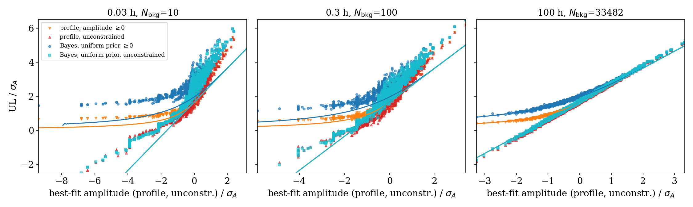
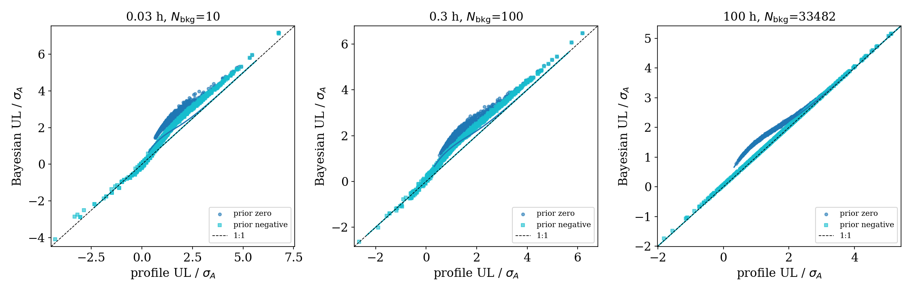
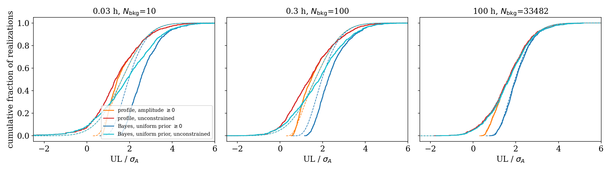
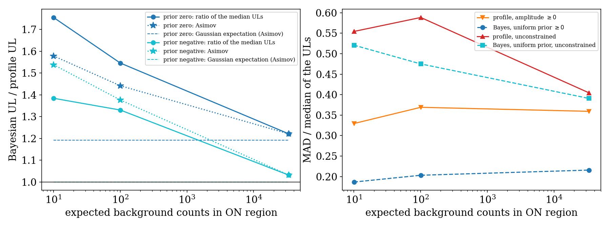
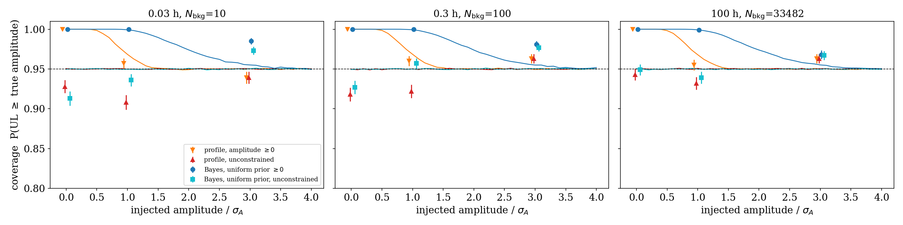
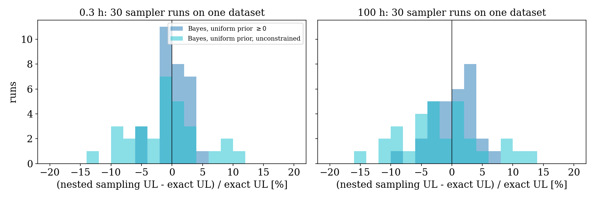
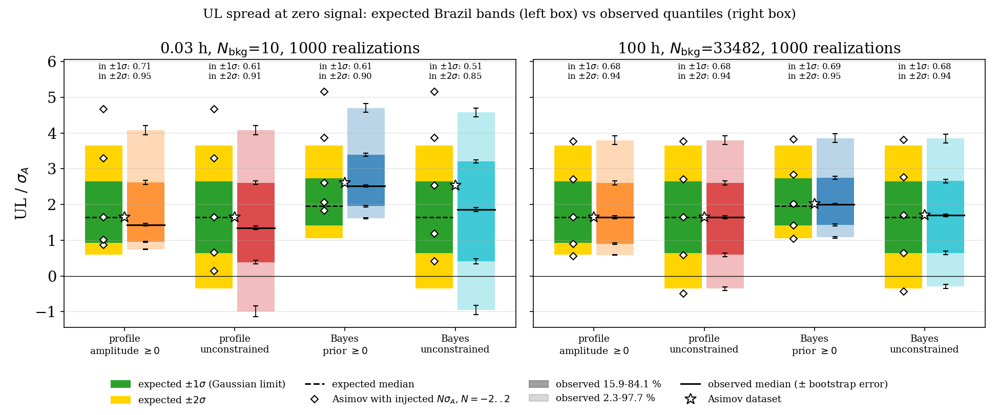

# Upper limits on a faint gamma-ray source: profile likelihood vs Bayesian

*Simulation study with gammapy v2 (dev), CTAO-South Prod5 IRFs. Companion to `UL-simulation-paper-script.ipynb`.*
*Code: `ul_simulation.py` (library), `ul_comparison_main.py` (paper figures), `ul_report.py` (this report: simulations + Fig. 1–6), `brazil_bands.py` (Fig. 7). Raw results: `report_results/*.ecsv`, `report_results/summary.json`, `report_results/brazil_summary.json`.*

*Version 2. Changes from version 1: a truly unconstrained case (same lower bound −1e-11 for the profile and the prior), Bayesian quantile 0.95 instead of 0.954, 1 000 realizations per configuration, coverage at all three exposures with independent seeds. Version 1 is in `archive_v1/` and in the git history.*

---

## 1. Summary

- **In the large-count regime both methods behave as statistical theory predicts.** At 100 h (33 500 background counts) the profile-likelihood and Bayesian upper limits (ULs) follow the Gaussian (Wilks) expectations realization by realization (Fig. 1, 2, 3). The observed Brazil bands match the expected ones within ≈ 0.1 σ_A (Fig. 7). Median UL / σ_A: 1.64 (profile) and 2.01 (Bayes, prior ≥ 0), against 1.645 and 1.96 expected.
- **Truly unconstrained ULs under-cover at low counts.** With no effective lower bound, the profile UL covers the true amplitude in 90.8 ± 0.9 % of the realizations at 0.03 h (1 σ_A injected) and 91.8–92.2 % at 0.3 h, instead of 95 % (Fig. 5). The Bayesian UL with an unbounded flat prior behaves similarly (91.3–93.6 %). 7–9 % of the unconstrained ULs are negative at 0.03–0.3 h (5 % expected). At 100 h coverage is consistent with 95 % to within ≈ 2.5 σ. **The constrained cases (amplitude ≥ 0) never under-cover significantly**: profile ≥ 93.9 %, Bayes ≥ 96.8 %.
- **The Bayesian UL with a flat prior ≥ 0 is always more conservative than the profile UL on the same data** (100 % of realizations at all exposures). The ratio of the median ULs is 1.22 at 100 h, close to the Gaussian prediction of 1.19. It grows to 1.55 at 0.3 h and 1.75 at 0.03 h. The growth comes from the Poisson regime: the likelihood has a long upper tail, the posterior integrates it, and the profile only uses the likelihood up to Δ = 2.71.
- **The unconstrained ULs are about 1.5× more spread than the constrained ones, and the Bayes ≥ 0 ULs are the least spread** (MAD/median 0.19–0.22, against 0.33–0.37 for profile ≥ 0 and 0.39–0.59 for the unconstrained cases). The Bayesian UL with prior ≥ 0 has a natural floor (≈ 1 σ_A).
- **Asimov ("expected") limit bands are reliable only at large counts.** At 0.03 h (10 background counts) the observed UL distributions are much more skewed than the Gaussian Brazil bands: only 51–61 % of the ULs fall inside the expected ±1σ band for three of the four cases (Fig. 7).
- **The nested sampling UL has a Monte Carlo noise of 2.6–6.6 % per run** (300 live points; Fig. 6). For a single free parameter the posterior quantile is computed exactly by grid integration (`"grid"`), which is used for all the Bayesian results.

---

## 2. Setup

| Item | Value |
|---|---|
| IRF | CTAO-South Prod5, 20 deg, `14MSTs37SSTs`, 180000 s |
| Region | ON circle r = 0.11 deg at 0.5 deg offset |
| Energy | reco 0.05–50 TeV, 6 bins/decade; fit range 0.05–50 TeV |
| Simulated sky | background only (power-law amplitude 1e-20); coverage runs inject 1 σ_A and 3 σ_A |
| Fit model | power law, index fixed at 2, **amplitude is the only free parameter** |
| Dataset | `SpectrumDataset` with known background (Cash statistic), type "on" |
| Exposures | 0.03 h, 0.3 h, 100 h → expected background in the ON region 10.0, 100.4, 33 482 counts |
| Realizations | main: 1 000 per exposure (seeds 0–999) + 1 Asimov. Coverage: 1 000 per (exposure, injected level), seeds 10000–10999 (1 σ_A) and 20000–20999 (3 σ_A) |

Four test cases are run on **the same faked dataset** for each realization:

| Case | Method | Lower bound | Bound / σ_A (0.03 h, 0.3 h, 100 h) |
|---|---|---|---|
| profile ≥ 0 | profile likelihood, Δ = 1.645² = 2.706 (one-sided 95 %) | amplitude ≥ 0 | 0, 0, 0 |
| profile unconstrained | same | amplitude ≥ −1e-11 | −22, −110, −3 133 |
| Bayes ≥ 0 | uniform prior, 0.95 posterior quantile | amplitude ≥ 0 | 0, 0, 0 |
| Bayes unconstrained | same | amplitude ≥ −1e-11 | −22, −110, −3 133 |

Upper bound: 1e-11 for all cases (≈ 22 to 3 000 σ_A, irrelevant).

**UL computation.** Both methods use the gammapy Cash likelihood of the dataset directly, with amplitude the only free parameter:

- **Profile:** the likelihood is minimised within the bounds, and the UL is the amplitude above the minimum where −2 ln L has risen by 2.706 (root finding). This is the quantity the `FluxPointsEstimator` stat scan approximates; the two agree to ≤ 0.015 σ_A on the version-1 setup. The fixed norm scan of the `FluxPointsEstimator` is too coarse for a range as wide as ±1e-11, so it is not used here.
- **Bayes:** the 0.95 quantile of the posterior exp(−stat/2) × uniform prior, integrated on a fine grid (exact for one free parameter). Nested sampling (UltraNest, 300 live points) is only used in §5.5 to measure its Monte Carlo noise.

**Unit σ_A.** Everything is expressed in units of the Asimov uncertainty σ_A = UL_profile(Asimov) / √Δ (Cowan et al. 2011). The values are σ_A = 4.6e-13, 9.1e-14 and 3.2e-15 cm⁻² s⁻¹ TeV⁻¹ at 0.03 h, 0.3 h and 100 h. In these units the Gaussian expectations do not depend on exposure. Note: by this definition the Asimov profile UL is exactly 1.645 σ_A at every exposure. At low counts σ_A is a convenient scale rather than the standard deviation of the best-fit amplitude: at 0.03 h the unconstrained best fit has a standard deviation of 1.35 σ_A and a median of −0.29 σ_A.

**Caveat on the unconstrained cases at low counts.** For amplitudes below ≈ −2e-14 the expected counts in the highest-energy bins become negative, and gammapy clips them to a tiny positive value inside the Cash statistic. 70 % (0.03 h) and 53 % (0.3 h) of the unconstrained best fits are in this region; none at 100 h. The unconstrained results at low counts therefore describe gammapy's likelihood as implemented, in a regime where the Poisson model with a negative signal is not strictly defined.

---

## 3. Statistical expectations (Gaussian / Wilks regime)

Assume the log-likelihood in the amplitude μ is parabolic, $-2\ln L(\mu) = (\mu-\hat\mu)^2/\sigma^2 + \text{const}$, with $\hat\mu \sim \mathcal N(\mu_\text{true},\sigma)$. Write $z=\hat\mu/\sigma$ and $k=\sqrt{\Delta}=1.645$. All quantities below are in units of σ.

**Profile likelihood UL** (one-sided 95 %, $\Delta=2.706$), parameter bounded at $l$:

$$
\text{UL}_\text{prof}(z) =
\begin{cases} z + k & z \ge l \\ z + \sqrt{(l-z)^2 + k^2} & z < l \end{cases}
$$

- For $z \ge l$ this is the textbook $\hat\mu + 1.645\,\sigma$. It has exact 95 % coverage for all $\mu_\text{true}$ when $l=-\infty$, and is negative for 5 % of the background-only realizations.
- With $l = 0$ the fit sits at the boundary for half of the background-only realizations. The UL then decreases smoothly towards 0 as $z \to -\infty$ (this is Cowan's $\tilde q_\mu$). Coverage becomes > 95 % near $\mu_\text{true}=0$, but the UL can become arbitrarily small. A "lucky" downward fluctuation of the background gives a UL much tighter than the experiment's sensitivity, which is the well-known motivation for CLs or power-constrained limits in HEP.
- On the Asimov dataset, $\text{UL}=1.645$ whatever the bound.

**Bayesian UL**, flat prior on $[a, \infty)$, posterior quantile $c = 0.95$. The posterior is a truncated Gaussian, so

$$
\text{UL}_\text{Bayes}(z) = z + \Phi^{-1}\!\left[\Phi(a-z) + c\,\big(1-\Phi(a-z)\big)\right].
$$

- With $a=-\infty$: $\text{UL}= z + 1.645$, **identical to the unbounded profile UL**. A flat prior on an unbounded location parameter gives exact frequentist coverage.
- With $a=0$ and Asimov ($z=0$): $\text{UL}=\Phi^{-1}(0.975)=1.96$. **Expected Bayes/profile ratio: 1.96/1.645 = 1.19.**
- The Bayesian UL with $a = 0$ is bounded from below (→ 0 only very slowly), so its scatter is smaller than the profile's. It over-covers near the boundary.

**Expected distributions under background only** ($z\sim\mathcal N(0,1)$, dashed lines in Fig. 3):

| | profile ≥ 0 | profile unbounded | Bayes ≥ 0 | Bayes unbounded |
|---|---|---|---|---|
| Asimov UL / σ | 1.645 | 1.645 | 1.96 | 1.645 |
| median UL / σ | 1.645 | 1.645 | 1.96 | 1.645 |
| fraction of negative ULs | 0 | 5 % | 0 | 5 % |
| coverage at μ_true = 0 | 100 % | 95 % | 100 % | 95 % |
| coverage at μ_true ≫ σ | 95 % | 95 % | 95 % | 95 % |

**Expected departures in the Poisson regime.** With 10–100 background counts spread over 18 energy bins, many bins have ≪ 1 expected count. The Cash likelihood in μ is then skewed, with a long upper tail, and the distribution of $\hat\mu$ is skewed too (most realizations have fewer counts than the mean, a few have many more). Expected consequences:

1. The Bayesian UL (an integral over the whole upper tail) increases relative to the profile UL (a local quantity: where Δ reaches 2.71).
2. The Bayes/profile ratio grows as counts decrease.
3. Wilks' theorem, and hence the 95 % coverage of the Δ = 2.71 rule, is no longer guaranteed. This is tested in §5.4.

---

## 4. Proposed figures

1. **UL vs best fit** (Fig. 1): checks each method against its expected curve, realization by realization, and shows the effect of the bounds.
2. **Paired Bayes vs profile UL** (Fig. 2): one point per realization, with the same data for both methods. This removes the Poisson scatter and isolates the difference between the two methods.
3. **Cumulative UL distributions** (Fig. 3): the full shape of the distributions against the expected one. This is what a reader of a catalogue of ULs actually sees.
4. **Ratio and spread vs background counts** (Fig. 4): the transition from the Poisson to the Gaussian regime in one plot. This is the most compact figure for the paper.
5. **Coverage vs injected signal** (Fig. 5): the frequentist property that justifies calling the number a "95 % UL".
6. **Sampler Monte Carlo noise** (Fig. 6): the precision of a single nested-sampling UL compared with the exact posterior quantile.
7. **Brazil bands** (Fig. 7): the spread of the ULs at zero signal against the Asimov expected-limit bands.

The original per-realization scatter plot with side histogram (`plot_lc_triangle`, in `ul_comparison_main.py`) remains useful as an illustration. Figures 2, 4 and 5 convey the comparison more directly.

---

## 5. Results: observed vs expected

### 5.1 UL vs best-fit amplitude



*Fig. 1. UL / σ_A vs maximum-likelihood amplitude of the unconstrained profile fit (same realization) / σ_A, 1 000 realizations per exposure. Lines show the Gaussian expectation of §3 for each case; the unconstrained profile and Bayes lines coincide.*

- **100 h:** the points sit on the expected curves for all four cases. This includes the boundary regime of profile ≥ 0 for $\hat\mu<0$ (orange points bending down) and the Bayes ≥ 0 floor (blue). The unconstrained profile and Bayes ULs lie on the same line, as expected.
- **0.3 h and 0.03 h:** the unconstrained best fit reaches −6 σ_A (0.3 h) and −9 σ_A (0.03 h); the distribution of $\hat\mu$ has a long negative tail (§2). All methods lie above the Gaussian curves, increasingly so for larger |μ̂|: the likelihood is wider than parabolic. For positive fluctuations the Bayesian ULs are further above the profile ULs, from the long upper tail of the Poisson likelihood.

### 5.2 Bayesian vs profile UL on the same data



*Fig. 2. Bayesian UL vs profile UL for the same realization. Lines show the expected relation (parametric in z); the dashed line is 1:1.*

- **Prior ≥ 0:** the Bayesian UL is larger than the profile UL in **100 %** of realizations at every exposure.
- **Unconstrained:** the two ULs are close to the 1:1 line, as expected (identical in the Gaussian limit). The Bayesian UL is larger in 89.7 %, 96.3 % and 100 % of realizations at 0.03 h, 0.3 h and 100 h.
- Ratio of the median ULs, Bayes / profile (the per-realization ratio is ill-defined when the unconstrained UL is ≈ 0):

| exposure | N_bkg | prior ≥ 0: medians (Asimov) | unconstrained: medians (Asimov) | Gaussian expectation, ≥ 0 / unconstrained |
|---|---|---|---|---|
| 0.03 h | 10 | 1.75 (1.58) | 1.38 (1.54) | 1.19 / 1.00 |
| 0.3 h | 100 | 1.55 (1.44) | 1.33 (1.38) | 1.19 / 1.00 |
| 100 h | 33 482 | 1.22 (1.22) | 1.03 (1.03) | 1.19 / 1.00 |

- With prior ≥ 0 the largest per-realization ratios (up to 2.2) occur where the profile UL is smallest, i.e. after a downward fluctuation. There the profile UL drops while the Bayesian UL stays near its floor.
- At 100 h the observed ratios are 2–3 % above the Gaussian expectation, from the residual non-parabolic shape of the likelihood (high-energy bins with few counts even at 100 h).

### 5.3 Distributions and spread



*Fig. 3. Cumulative distribution of UL / σ_A over 1 000 background-only realizations (solid) vs the Gaussian expectation (dashed).*



*Fig. 4. Left: Bayesian/profile ratio of the median ULs vs background counts, Asimov ratio, and Gaussian expectation (1.19 for prior ≥ 0, 1.00 unconstrained). Right: relative spread (MAD/median) of the ULs.*

| exposure | case | median UL/σ_A (expected) | Asimov UL/σ_A (expected) | MAD/median | negative ULs (expected) |
|---|---|---|---|---|---|
| 0.03 h | profile ≥ 0 | 1.43 (1.645) | 1.645 (1.645) | 0.33 | 0 |
| | profile unconstr. | 1.35 (1.645) | 1.645 (1.645) | 0.55 | 7.2 % (5 %) |
| | Bayes ≥ 0 | 2.52 (1.96) | 2.60 (1.96) | 0.19 | 0 |
| | Bayes unconstr. | 1.86 (1.645) | 2.53 (1.645) | 0.52 | 8.7 % (5 %) |
| 0.3 h | profile ≥ 0 | 1.46 (1.645) | 1.645 (1.645) | 0.37 | 0 |
| | profile unconstr. | 1.39 (1.645) | 1.645 (1.645) | 0.59 | 8.2 % (5 %) |
| | Bayes ≥ 0 | 2.26 (1.96) | 2.37 (1.96) | 0.20 | 0 |
| | Bayes unconstr. | 1.84 (1.645) | 2.26 (1.645) | 0.48 | 7.3 % (5 %) |
| 100 h | profile ≥ 0 | 1.64 (1.645) | 1.645 (1.645) | 0.36 | 0 |
| | profile unconstr. | 1.64 (1.645) | 1.645 (1.645) | 0.40 | 5.7 % (5 %) |
| | Bayes ≥ 0 | 2.01 (1.96) | 2.01 (1.96) | 0.22 | 0 |
| | Bayes unconstr. | 1.70 (1.645) | 1.70 (1.645) | 0.39 | 5.1 % (5 %) |

*The uncertainty on a median from 1 000 realizations is ≈ ±0.04 σ_A; on a fraction of 5 %, ±0.7 %. The Asimov profile UL is 1.645 by definition of σ_A (§2).*

Observations:

- **Large counts (100 h):** all medians, Asimov values and fractions of negative ULs agree with the Gaussian expectation. The Bayesian values are 2–3 % high, see §5.2.
- **Profile, low counts:** the medians are 11–18 % below 1.645. Many realizations have a downward fluctuation ($\hat\mu < 0$ in 72 % of the cases at 0.03 h, instead of 50 %).
- **Bayes, low counts:** the medians are 12–29 % above the Gaussian expectation, from the heavy upper tail of the Poisson likelihood. The Asimov UL is no longer the median for the unconstrained Bayes case (2.53 vs 1.86 at 0.03 h).
- **Negative ULs:** without a bound, 7–9 % of the ULs are negative at low counts, more than the 5 % expected.
- **Spread:** the Bayes ≥ 0 ULs are the most stable (MAD/median ≈ 0.2 at all exposures). The unconstrained ULs are the most spread (0.4–0.6), because the UL tracks $\hat\mu$ one-to-one.
- **Constrained / unconstrained** (ratio of median ULs):
  - Profile: 1.07, 1.06, 1.00 at 0.03 h, 0.3 h, 100 h (expected 1.00: the bound only changes the ULs below the median).
  - Bayes: 1.35, 1.23, 1.18 (expected 1.96/1.645 = 1.19).

### 5.4 Coverage



*Fig. 5. Fraction of realizations with UL ≥ injected amplitude (1 000 realizations per point, binomial errors ±0.007 at 95 %). Lines: Gaussian expectation for each case. At zero injected signal the coverage of the ≥ 0 cases is 1 by construction (UL ≥ 0).*

| exposure | injected / σ_A | profile ≥ 0 | profile unconstr. | Bayes ≥ 0 | Bayes unconstr. |
|---|---|---|---|---|---|
| 0.03 h | 0 | 1.000 | **0.928** | 1.000 | **0.913** |
| | 1 | 0.957 | **0.908** | 1.000 | **0.936** |
| | 3 | 0.939 | 0.939 | 0.985 | 0.973 |
| 0.3 h | 0 | 1.000 | **0.918** | 1.000 | **0.927** |
| | 1 | 0.960 | **0.922** | 1.000 | 0.957 |
| | 3 | 0.963 | 0.963 | 0.981 | 0.977 |
| 100 h | 0 | 1.000 | 0.943 | 1.000 | 0.949 |
| | 1 | 0.955 | 0.932 | 0.999 | 0.939 |
| | 3 | 0.963 | 0.963 | 0.968 | 0.967 |

*Gaussian expectation: 0.95 for the unconstrained cases at all levels; for the ≥ 0 cases, 1.00 at 0, ≈ 0.97 (profile) / 1.00 (Bayes) at 1 σ_A and ≈ 0.95 / 0.96 at 3 σ_A. Bold: below 0.95 by more than 3 binomial errors. The four cases share the same realizations, so their values are correlated.*

- **The unconstrained ULs under-cover at low counts.** At 0.03 h the profile coverage is 0.928 (zero signal) and 0.908 (1 σ_A), i.e. 3–6 binomial errors below 95 %; at 0.3 h 0.918–0.922. The unbounded Bayesian UL is similar (0.913–0.936). At zero signal the deficit is the excess of negative ULs of §5.3. At 3 σ_A the coverage is back to 0.94–0.98.
- **The constrained ULs do not under-cover.** Profile ≥ 0: 0.939–0.963 (the lowest value, 0.939 at 0.03 h and 3 σ_A, is 1.6 errors below 95 %). Bayes ≥ 0 over-covers: 1.00 at 1 σ_A and 0.97–0.99 at 3 σ_A. This is the price paid for its stability.
- **100 h:** the unconstrained values (0.932–0.949 at 0 and 1 σ_A, 0.963–0.967 at 3 σ_A) are within ≈ 2.5 binomial errors of 95 %, in both directions; the Gaussian regime is recovered.
- In short: in the Poisson regime the Δ = 2.71 rule (and the flat unbounded prior) is not a 95 % UL without a physical bound. The physical bound (amplitude ≥ 0) restores coverage ≥ 94 %.

### 5.5 Precision of nested sampling



*Fig. 6. 30 independent UltraNest runs (300 live points) on the same dataset (seed 0), relative to the exact posterior quantile from grid integration.*

| exposure | prior ≥ 0: std (mean) | prior unconstr.: std (mean) |
|---|---|---|
| 0.3 h | 2.6 % (+0.2 %) | 5.7 % (−1.2 %) |
| 100 h | 3.3 % (+0.1 %) | 6.6 % (−1.7 %) |

- The sampler is unbiased within the precision of 30 runs (±0.5–1.2 %), but a single run carries a 3–7 % Monte Carlo error on the UL.
- The error is larger when the prior volume is huge compared with the posterior (unconstrained prior [−1e-11, 1e-11]: the posterior occupies ~10⁻² (0.3 h) to 10⁻³ (100 h) of it).
- The error is subdominant to the realization-to-realization scatter (MAD/median 0.2–0.6), but not negligible for Asimov-based "expected UL" numbers or for ratios quoted to two decimals.
- Increasing `min_num_live_points`, or using the exact grid integration when only one parameter is free, removes it.

### 5.6 Spread of the ULs at zero signal (Brazil bands)

The "Brazil bands" are the expected-limit bands of Cowan et al. (2011): the median and the ±1σ / ±2σ quantiles (2.3, 15.9, 50, 84.1, 97.7 %) of the UL distribution under the background-only hypothesis. They were computed in three ways for 0.03 h (10 background counts, Poisson regime) and 100 h (33 500 counts, Gaussian regime):

1. **Expected (Asimov, Gaussian limit).** The background-only Asimov dataset gives σ_A. Assuming $\hat\mu/\sigma_A = z \sim \mathcal N(0,1)$ and using that the UL is a monotonic function of $z$ (§3), the quantile of the UL at $\Phi(N)$ is $\mathrm{UL}(z=N)$. For the unbounded profile this is Cowan's $\mathrm{UL}_N = \sigma_A(1.645+N)$; the bounded and Bayesian versions use the formulas of §3. In units of σ_A the whole band, not only the median, follows from Asimov.
2. **Shifted Asimov.** UL computed on Asimov datasets with an injected amplitude $N\sigma_A$, $N = -2 \dots 2$. This uses the true Poisson likelihood shape around a best fit at $N\sigma_A$ (no parabolic approximation), but still assumes $\hat\mu$ is Gaussian with width σ_A.
3. **Observed.** Empirical quantiles of the 1 000 background-only realizations of the main run, with bootstrap uncertainties.



*Fig. 7. For each case: expected Brazil band (left box: green ±1σ, yellow ±2σ, dashed median) with the shifted-Asimov ULs (diamonds), and the observed quantiles of 1 000 realizations (right box, case colour: dark 15.9–84.1 %, light 2.3–97.7 %, black line median, error bars = bootstrap uncertainty of each quantile). Star: background-only Asimov UL. The numbers give the fraction of observed ULs inside the expected ±1σ and ±2σ bands (nominal 0.683 and 0.954).*

**UL / σ_A at the quantiles −2σ, −1σ, median, +1σ, +2σ** (observed ± bootstrap error / expected Gaussian / shifted Asimov):

| exposure | case | −2σ | −1σ | median | +1σ | +2σ |
|---|---|---|---|---|---|---|
| 0.03 h | profile ≥ 0 | 0.74±0.01 / 0.59 / 0.87 | 0.95±0.01 / 0.93 / 1.02 | 1.43±0.03 / 1.65 / 1.65 | 2.62±0.06 / 2.65 / 3.29 | 4.08±0.13 / 3.65 / 4.67 |
| | profile unconstr. | −0.99±0.15 / −0.35 / 0.14 | 0.39±0.05 / 0.65 / 0.66 | 1.35±0.05 / 1.65 / 1.64 | 2.61±0.05 / 2.65 / 3.29 | 4.08±0.13 / 3.65 / 4.67 |
| | Bayes ≥ 0 | 1.61±0.02 / 1.05 / 1.83 | 1.96±0.02 / 1.41 / 2.05 | 2.52±0.03 / 1.96 / 2.60 | 3.39±0.04 / 2.73 / 3.87 | 4.70±0.12 / 3.66 / 5.15 |
| | Bayes unconstr. | −0.95±0.13 / −0.36 / 0.41 | 0.41±0.07 / 0.64 / 1.18 | 1.86±0.06 / 1.64 / 2.53 | 3.21±0.04 / 2.64 / 3.86 | 4.58±0.12 / 3.64 / 5.15 |
| 100 h | profile ≥ 0 | 0.59±0.01 / 0.59 / 0.56 | 0.90±0.02 / 0.93 / 0.89 | 1.64±0.04 / 1.65 / 1.65 | 2.60±0.05 / 2.65 / 2.71 | 3.80±0.12 / 3.65 / 3.76 |
| | profile unconstr. | −0.35±0.05 / −0.35 / −0.50 | 0.59±0.05 / 0.65 / 0.58 | 1.64±0.04 / 1.65 / 1.64 | 2.60±0.05 / 2.65 / 2.71 | 3.80±0.12 / 3.65 / 3.76 |
| | Bayes ≥ 0 | 1.08±0.01 / 1.05 / 1.04 | 1.43±0.02 / 1.41 / 1.42 | 2.01±0.03 / 1.96 / 2.01 | 2.75±0.05 / 2.73 / 2.83 | 3.85±0.12 / 3.66 / 3.82 |
| | Bayes unconstr. | −0.29±0.05 / −0.36 / −0.44 | 0.64±0.05 / 0.64 / 0.63 | 1.69±0.04 / 1.64 / 1.70 | 2.65±0.05 / 2.64 / 2.76 | 3.84±0.12 / 3.64 / 3.81 |

**Fraction of observed ULs inside the expected bands** (binomial error ±0.015 for ±1σ, ±0.007 for ±2σ):

| exposure | case | in ±1σ (0.683) | in ±2σ (0.954) | below −2σ / above +2σ (0.023 each) |
|---|---|---|---|---|
| 0.03 h | profile ≥ 0 | 0.707 | 0.954 | 0.000 / 0.046 |
| | profile unconstr. | 0.612 | 0.909 | 0.045 / 0.046 |
| | Bayes ≥ 0 | 0.610 | 0.895 | 0.000 / 0.105 |
| | Bayes unconstr. | 0.505 | 0.854 | 0.055 / 0.091 |
| 100 h | profile ≥ 0 | 0.675 | 0.942 | 0.024 / 0.034 |
| | profile unconstr. | 0.675 | 0.943 | 0.023 / 0.034 |
| | Bayes ≥ 0 | 0.686 | 0.949 | 0.015 / 0.036 |
| | Bayes unconstr. | 0.681 | 0.944 | 0.020 / 0.036 |

Interpretation:

- **100 h (Gaussian regime): the Asimov bands describe the ULs.** Every observed quantile agrees with the Gaussian expectation to within ≈ 1–2 bootstrap errors (≤ 0.15 σ_A), for both methods and both bounds, and the band fractions are 0.675–0.686 and 0.942–0.949. The upper tail is slightly heavier than Gaussian (3.4–3.6 % above +2σ instead of 2.3 %; +2σ edge 3.80–3.85 vs 3.65), consistent with the residual non-parabolic likelihood. The shifted-Asimov points are equally good.
- **0.03 h (Poisson regime): the Gaussian Asimov bands do not describe the ULs.** The distributions are skewed: compressed at low values for the constrained cases, with long tails on both sides for the unconstrained cases, and a long upper tail for all.
  - **Profile ≥ 0:** the band fractions are close to nominal (0.71 / 0.95), but the band is shifted: the median is 13 % low (1.43 vs 1.645) and no UL falls below the expected −2σ edge, while 4.6 % are above +2σ.
  - **Unconstrained (profile and Bayes):** the lower band reaches −1 σ_A, against −0.35 expected; 4.5–5.5 % of the ULs are below the expected −2σ edge and 4.6–9.1 % above +2σ. Only 51–61 % are inside the expected ±1σ band. This is the same effect as the under-coverage of §5.4.
  - **Bayes ≥ 0:** the whole band is shifted upwards by 24–53 %; 10.5 % of the ULs are above +2σ.
- **The shifted Asimov** improves on the Gaussian formula for the upper edges at 0.03 h (it captures the wider Poisson likelihood for upward fluctuations), but over-shoots them (+2σ: 4.67 vs 4.08 observed for the profile, 5.15 vs 4.70 for Bayes ≥ 0) and does not reproduce the lower edges or the median. These depend on the non-Gaussian, discrete distribution of $\hat\mu$ for 10 counts, which no single Asimov dataset can represent. Only toy Monte Carlo gives the correct band there.
- **Precision of the extreme quantiles at 0.03 h:** with discrete counts, the bootstrap error underestimates the run-to-run scatter of the ±2σ edges. In version 1 (seeds 2000–2999) the profile ≥ 0 +2σ edge was 4.71 ± 0.24, against 4.08 ± 0.13 here.
- **Practical consequence:** an "expected UL" or sensitivity band computed from Asimov (σ_A and the Gaussian formulas, as is common practice) is reliable at high counts. At ~10 background counts it misplaces the median and the upper tail of the ULs; toy Monte Carlo bands should be used.

---

## 6. Pros and cons for faint-source ULs with IACTs / CTAO

| | Profile likelihood (frequentist) | Bayesian (flat prior) |
|---|---|---|
| **Statistical guarantee** | Coverage ≈ 95 % by construction in the Wilks regime (checked at 33 500 counts). **With a physical bound (≥ 0) coverage stays ≥ 94 % down to 10 counts; without it, it drops to 91–93 % at 10–100 counts.** Directly comparable with published IACT and Fermi-LAT ULs, which mostly use Δ = 2.71 profile or Rolke / Feldman–Cousins. | Credible interval: answers "where is the flux, given the data and my prior". No coverage guarantee in general. With prior ≥ 0 it over-covers (≥ 97 %); with an unbounded prior it behaves like the unconstrained profile (under-covers at low counts). |
| **Behaviour at zero / negative excess** | With a physical bound the UL can become very small after a downward fluctuation (0.6–0.75 σ_A at the −2σ quantile); with no bound it is negative in 7–8 % of cases at 10–100 counts. Both are hard to interpret and motivate CLs or power-constrained limits. | With prior ≥ 0: natural floor near 1 σ_A, the UL never claims more than the instrument can do. Fewer "too good" limits, and the smallest scatter (MAD/median ≈ 0.2 vs 0.33–0.37). |
| **Low counts (short exposure, high energy, small ROI)** | Local criterion (Δ = 2.71) on a skewed likelihood: median UL 11–13 % below the Asimov value at 10–100 counts. | Integrates the full Poisson tail, giving larger ULs: 1.55–1.75× the profile at 10–100 background counts vs 1.19× expected in the Gaussian limit. Arguably the more honest number at very low counts, but strongly prior-dependent there. |
| **Prior dependence** | None (but the choice of bound matters, see coverage). | Central. Uniform in amplitude favours large fluxes; a log-uniform or Jeffreys prior would lower the ULs, most strongly in the Poisson regime. Must be stated explicitly in a paper. |
| **Nuisance parameters** (spectral index, background normalisation, IRF systematics) | Profiled: a maximisation per scan point. Can under-cover when the nuisance parameters are poorly constrained. | Marginalised. Naturally includes uncertainties with priors (e.g. a Gaussian systematic on effective area). This is the main practical advantage once more than one parameter is free. |
| **Cost** (measured, 1 core, one free parameter) | ≈ 0.2 s per UL (direct minimisation + root finding); 0.8–0.9 s with the `FluxPointsEstimator` scan. Deterministic. | ≈ 0.9 s per UL with the exact grid integration (one parameter only). 3.4–5.6 s with nested sampling (300 live points), growing with the number of free parameters, plus 3–7 % Monte Carlo noise. |
| **Combination / population studies** | Likelihood profiles can be stacked (joint likelihood). | Posteriors combine naturally in hierarchical (population) models, e.g. stacking non-detected sources or dark-matter J-factor marginalisation. |
| **Reporting** | One number + Δ convention. Easy to reproduce. | Requires prior, quantile and sampler settings. Posterior samples carry more information (shape, multimodality). |

**Recommendations for the paper / use case**

1. For **catalogue-like or survey ULs** (many positions or energy bins, comparison with literature), use the **profile likelihood with a physical bound (≥ 0)**. It keeps ≥ 94 % coverage at all counts studied here. Quote the sensitivity (or Asimov UL) next to each UL, so that "lucky" low limits are recognisable, or adopt a power-constrained limit (UL = max(UL, sensitivity)).
2. **Do not use unconstrained ULs at low counts** (≲ 100 background counts): they are negative in 6–9 % of cases and under-cover (91–93 %).
3. For **single deep targets with poorly constrained nuisance parameters**, or for population and dark-matter analyses, the **Bayesian approach** with a prior ≥ 0 is preferable. State the prior explicitly and show the prior sensitivity (uniform vs log-uniform).
4. **Use consistent confidence levels:** a 0.95 posterior quantile with Δ = 2.706 (done in this version; 0.954 inflates the Bayesian ULs by ≈ 2 %).
5. For **one free parameter**, compute the Bayesian UL with the exact grid integration, or check the sampler against it. When the sampler is needed, raise the live points until the quantile error is ≪ the effect being studied.
6. **Expected-limit (Brazil) bands from Asimov** are fine at large counts; at ≲ 100 counts use toy Monte Carlo.

---

## 7. Limitations and possible follow-ups

- 1 000 realizations per configuration give ±0.007 on coverage at 95 % and ±0.04 σ_A on medians. The ±2σ quantiles at 0.03 h are less precise than their bootstrap errors suggest (§5.6).
- The unconstrained results at low counts depend on how gammapy handles negative expected counts (§2).
- Only the amplitude is free and the background is known exactly; nuisance parameters are where the two approaches differ most.
- One prior shape (uniform in amplitude).
- Feldman–Cousins / CLs / power-constrained limits are not included.

---

## 8. Reproducibility

```
python ul_report.py      # reruns or reloads report_results/*.ecsv, writes report_figures/fig1-6 and summary.json
python brazil_bands.py   # uses report_results/uls_main.ecsv, writes fig7 and brazil_summary.json
```

- Main run: 3 003 realizations (3 × 1 000 + 3 Asimov), 909 s.
- Coverage: 6 000 realizations, 1 725 s.
- Sampler noise: 60 realizations, 85 s.
- Brazil bands (shifted Asimov only, the toys are those of the main run): ≈ 1 min.
- All on 8 cores (`N_JOBS` in `ul_report.py`), gammapy dev (`2.0.dev3770`), UltraNest 4.4.0.
- Delete `report_results/*.ecsv` (or set `recompute = True` in `ul_report.py`) to rerun the simulations.
- Seeds are fixed; the nested sampler itself is not seeded, so nested-sampling ULs reproduce only to within the ≈ 3–7 % of §5.5. All other ULs are deterministic.
